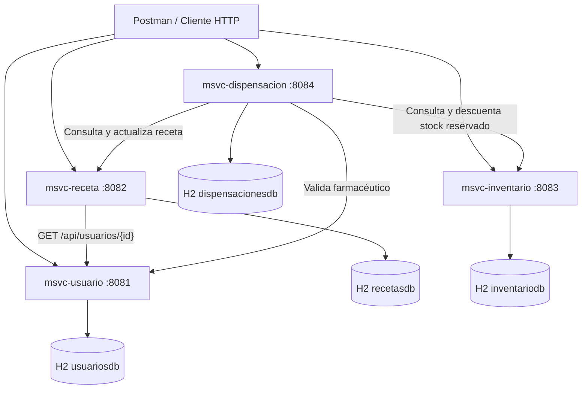

<div align="center">

# 💊 RecetaYa

### Gestión digital de recetas médicas · Arquitectura de microservicios con Spring Boot y H2


**Proyecto académico — Java: Diseño y Construcción de Soluciones Nativas en Nube (JVY0101)**

</div>

---

## 📖 Descripción

**RecetaYa** es un sistema académico para digitalizar la emisión y dispensación de recetas médicas en una cadena de farmacias. Permite registrar médicos y farmacéuticos, emitir recetas, administrar existencias de medicamentos por sucursal y registrar entregas.

El backend está dividido en **cuatro microservicios independientes**, desarrollados con **Java 21**, **Spring Boot 4.1.1** y **Maven**. Cada uno expone una API REST y tiene una base **H2 en memoria**. La comunicación local entre servicios se realiza mediante **Spring `RestClient`** y JSON.

> **Alcance de esta versión:** demostración académica local, sin interfaz frontend, JWT, AWS, API Gateway ni mensajería asíncrona. El caso original contempla autenticación/autorización y reserva asíncrona con SQS y Lambda; **esas funciones no están implementadas** aquí.

## 🧰 Stack tecnológico y dependencias

| Tecnología / dependencia | Uso |
|---|---|
| Java 21 | Lenguaje de programación |
| Spring Boot 4.1.1 | Desarrollo de las aplicaciones |
| Spring Web / Spring MVC | Controladores y endpoints REST |
| Spring `RestClient` | Llamadas HTTP entre microservicios |
| Spring Data JPA | Repositorios y persistencia |
| Hibernate | Mapeo objeto-relacional (ORM) |
| H2 Database | Base de datos relacional en memoria |
| Bean Validation | Validaciones como `@NotNull`, `@NotBlank` y `@Min` |
| Lombok | Dependencia disponible; las entidades mostradas usan métodos explícitos cuando procede |
| Apache Maven / Maven Wrapper | Compilación, pruebas y empaquetado |
| Postman | Pruebas de endpoints REST |
| Git y GitHub | Versionamiento y entrega |
| VS Code | Entorno de desarrollo |

## 🏗️ Arquitectura



**Separación de responsabilidades:** cada microservicio dispone de sus propias capas `controller`, `service`, `repository`, `model` y de DTOs para respuestas e integración. **Ningún microservicio accede directamente a las tablas de otro.**

### Microservicios

| Servicio | Puerto | Base H2 | Función principal |
|---|---:|---|---|
| `msvc-usuario` | `8081` | `usuariosdb` | Gestión de usuarios con roles `MEDICO` y `FARMACEUTICO` |
| `msvc-receta` | `8082` | `recetasdb` | Emisión y consulta de recetas; validación del médico |
| `msvc-inventario` | `8083` | `inventariodb` | Catálogo por sucursal, stock disponible y reservado |
| `msvc-dispensacion` | `8084` | `dispensacionesdb` | Validación del farmacéutico y entrega de recetas reservadas |

## 📂 Estructura del proyecto

```text
RecetaYa/
├── .vscode/                         # Configuración local de VS Code (opcional)
├── msvc-usuario/
│   ├── pom.xml
│   └── src/main/
│       ├── java/cl/recetaya/usuario/
│       │   ├── controller/
│       │   ├── dto/
│       │   ├── model/
│       │   ├── repository/
│       │   ├── service/
│       │   └── MsvcUsuarioApplication.java
│       └── resources/application.properties
├── msvc-receta/
│   ├── pom.xml
│   └── src/main/
│       ├── java/cl/recetaya/receta/
│       │   ├── controller/
│       │   ├── dto/
│       │   ├── model/
│       │   ├── repository/
│       │   ├── service/
│       │   └── MsvcRecetaApplication.java
│       └── resources/application.properties
├── msvc-inventario/
│   ├── pom.xml
│   └── src/main/
│       ├── java/cl/recetaya/inventario/
│       │   ├── controller/
│       │   ├── dto/
│       │   ├── model/
│       │   ├── repository/
│       │   ├── service/
│       │   └── MsvcInventarioApplication.java
│       └── resources/application.properties
├── msvc-dispensacion/
│   ├── pom.xml
│   └── src/main/
│       ├── java/cl/recetaya/dispensacion/
│       │   ├── controller/
│       │   ├── dto/
│       │   ├── model/
│       │   ├── repository/
│       │   ├── service/
│       │   └── MsvcDispensacionApplication.java
│       └── resources/application.properties
└── README.md
```

## 🗃️ Modelo de datos

| Entidad | Atributos principales |
|---|---|
| `Usuario` | `id`, `nombre`, `email`, `rol`, `activo` |
| `Receta` | `id`, `medicoId`, `pacienteId`, `medicamentoId`, `sucursal`, `estado` |
| `Inventario` | `id`, `medicamentoId`, `medicamento`, `sucursal`, `stockDisponible`, `stockReservado` |
| `Dispensacion` | `id`, `recetaId`, `farmaceuticoId`, `fecha`, `estado` |

La entidad `Receta` referencia a otros servicios mediante identificadores numéricos. **Esos identificadores no constituyen relaciones `@ManyToOne` entre bases separadas.**

**Estados de receta:** `PENDIENTE_RESERVA` → `RESERVADA` → `DISPENSADA`. También se contempla `SIN_STOCK`.

## ⚙️ Requisitos y ejecución local

1. Instalar **JDK 21**, **Git** y, opcionalmente, VS Code y Postman.
2. Clonar el repositorio:

```bash
git clone <URL-DE-TU-REPOSITORIO>
cd RecetaYa
```

3. En **cuatro terminales distintas**, iniciar un servicio por terminal. En Windows PowerShell:

```powershell
# Terminal 1 — Usuario
cd msvc-usuario
.\mvnw.cmd spring-boot:run
```

```powershell
# Terminal 2 — Receta (desde RecetaYa)
cd msvc-receta
.\mvnw.cmd spring-boot:run
```

```powershell
# Terminal 3 — Inventario (desde RecetaYa)
cd msvc-inventario
.\mvnw.cmd spring-boot:run
```

```powershell
# Terminal 4 — Dispensación (desde RecetaYa)
cd msvc-dispensacion
.\mvnw.cmd spring-boot:run
```

> Las instrucciones anteriores suponen que cada terminal nueva comienza en la raíz `RecetaYa`. Conservar encendidos los servicios de Usuario, Receta e Inventario es necesario para que Dispensación pueda comunicarse con ellos.

### Compilar, probar y empaquetar con Maven

Ejecutar desde **cada carpeta de microservicio**:

```powershell
.\mvnw.cmd clean
.\mvnw.cmd test
.\mvnw.cmd package
```

Si compila correctamente, Maven genera un archivo `.jar` en la carpeta `target/` del servicio correspondiente. No se deben omitir las pruebas para demostrar correctamente el ciclo de vida con Maven.

## 🧪 APIs REST

### 👤 Usuario — `http://localhost:8081`

| Método | Endpoint | Acción |
|---|---|---|
| GET | `/api/usuarios` | Listar usuarios |
| GET | `/api/usuarios/{id}` | Consultar usuario |
| POST | `/api/usuarios` | Crear usuario |
| PUT | `/api/usuarios/{id}` | Actualizar usuario |
| DELETE | `/api/usuarios/{id}` | Eliminar usuario |

### 📋 Receta — `http://localhost:8082`

| Método | Endpoint | Acción |
|---|---|---|
| GET | `/api/recetas` | Listar recetas |
| GET | `/api/recetas/{id}` | Consultar receta |
| GET | `/api/recetas/medico/{id}` | Consultar por médico |
| GET | `/api/recetas/estado/{estado}` | Filtrar por estado |
| POST | `/api/recetas` | Crear receta |
| PUT | `/api/recetas/{id}` | Actualizar receta pendiente |
| PATCH | `/api/recetas/{id}/estado?estado=RESERVADA` | Actualizar estado (provisional) |
| DELETE | `/api/recetas/{id}` | Eliminar receta pendiente |

### 💊 Inventario — `http://localhost:8083`

| Método | Endpoint | Acción |
|---|---|---|
| GET | `/api/inventarios` | Listar inventarios |
| GET | `/api/inventarios/{id}` | Consultar inventario |
| GET | `/api/inventarios/sucursal?nombre=Santiago Centro` | Filtrar por sucursal |
| GET | `/api/inventarios/medicamento/{id}?sucursal=Santiago Centro` | Buscar medicamento en sucursal |
| POST | `/api/inventarios` | Registrar medicamento |
| PUT | `/api/inventarios/{id}` | Actualizar inventario |
| PATCH | `/api/inventarios/{id}/reservar` | Reservar stock |
| PATCH | `/api/inventarios/{id}/liberar` | Liberar reserva |
| PATCH | `/api/inventarios/{id}/dispensar` | Descontar stock reservado |
| DELETE | `/api/inventarios/{id}` | Eliminar inventario sin reservas |

### 🧾 Dispensación — `http://localhost:8084`

| Método | Endpoint | Acción |
|---|---|---|
| GET | `/api/dispensaciones` | Listar dispensaciones |
| GET | `/api/dispensaciones/{id}` | Consultar dispensación |
| GET | `/api/dispensaciones/receta/{recetaId}` | Buscar por receta |
| GET | `/api/dispensaciones/farmaceutico/{id}` | Buscar por farmacéutico |
| POST | `/api/dispensaciones` | Dispensar receta reservada |
| PUT | `/api/dispensaciones/{id}` | Corregir farmacéutico |
| DELETE | `/api/dispensaciones/{id}` | Eliminar registro administrativo local |

## 🔁 Prueba básica del flujo en Postman

**1. Registrar un médico**

```http
POST http://localhost:8081/api/usuarios
Content-Type: application/json
```

```json
{
  "nombre": "Carlos Ramirez",
  "email": "carlos@recetaya.cl",
  "rol": "MEDICO",
  "activo": true
}
```

**2. Registrar un farmacéutico**

```http
POST http://localhost:8081/api/usuarios
Content-Type: application/json
```

```json
{
  "nombre": "Ana Torres",
  "email": "ana@recetaya.cl",
  "rol": "FARMACEUTICO",
  "activo": true
}
```

**3. Registrar el medicamento**

```http
POST http://localhost:8083/api/inventarios
Content-Type: application/json
```

```json
{
  "medicamentoId": 10,
  "medicamento": "Paracetamol 500 mg",
  "sucursal": "Santiago Centro",
  "stockDisponible": 20,
  "stockReservado": 0
}
```

**4. Emitir la receta** (ajustar `medicoId` al ID devuelto por Usuario)

```http
POST http://localhost:8082/api/recetas
Content-Type: application/json
```

```json
{
  "medicoId": 1,
  "pacienteId": 100,
  "medicamentoId": 10,
  "sucursal": "Santiago Centro"
}
```

**5. Reservar una unidad** (ajustar el ID del inventario):

```http
PATCH http://localhost:8083/api/inventarios/1/reservar
Content-Type: application/json
```

```json
{"cantidad": 1}
```

**6. Marcar la receta como reservada** (paso manual provisional):

```http
PATCH http://localhost:8082/api/recetas/1/estado?estado=RESERVADA
```

**7. Registrar la dispensación** (ajustar IDs reales):

```http
POST http://localhost:8084/api/dispensaciones
Content-Type: application/json
```

```json
{
  "recetaId": 1,
  "farmaceuticoId": 2
}
```

**8. Comprobar resultados:** consultar `GET /api/recetas/1`, `GET /api/inventarios/1` y `GET /api/dispensaciones` en sus respectivos puertos.

> **Limitación importante:** las reservas actualmente se acumulan por medicamento y sucursal, **no están asociadas a un `recetaId` concreto**. La operación de dispensación no es atómica entre microservicios; el ejemplo sirve para la demostración local y requiere mejoras de consistencia e idempotencia para escenarios reales.

## 🗄️ Consolas H2

| Servicio | Consola | JDBC URL | Usuario |
|---|---|---|---|
| Usuario | http://localhost:8081/h2-console | `jdbc:h2:mem:usuariosdb` | `sa` |
| Receta | http://localhost:8082/h2-console | `jdbc:h2:mem:recetasdb` | `sa` |
| Inventario | http://localhost:8083/h2-console | `jdbc:h2:mem:inventariodb` | `sa` |
| Dispensación | http://localhost:8084/h2-console | `jdbc:h2:mem:dispensacionesdb` | `sa` |

**Contraseña:** vacía en las cuatro bases. Cada consola está disponible mientras su microservicio esté ejecutándose.

```sql
-- Ejecutar dentro de la consola correspondiente.
SELECT * FROM USUARIOS;
SELECT * FROM RECETAS;
SELECT * FROM INVENTARIOS;
SELECT * FROM DISPENSACIONES;
```

> Las bases `jdbc:h2:mem:` **no conservan registros al detener la aplicación**. Los `SELECT` deben ejecutarse en la consola de su base correspondiente; no todas las tablas existen en una sola H2.

## 📦 Formato de respuestas y errores

Las respuestas de la API utilizan un objeto con `mensaje`, `datos` y `fecha`:

```json
{
  "mensaje": "Usuario creado correctamente",
  "datos": {
    "id": 1,
    "nombre": "Carlos Ramirez",
    "email": "carlos@recetaya.cl",
    "rol": "MEDICO",
    "activo": true
  },
  "fecha": "2026-10-10T18:00:00"
}
```

| Código HTTP | Significado |
|---|---|
| `200 OK` | Consulta, actualización o eliminación con mensaje |
| `201 Created` | Registro creado |
| `400 Bad Request` | Datos inválidos o rol no permitido |
| `404 Not Found` | Registro inexistente |
| `409 Conflict` | Duplicado, transición inválida o stock insuficiente |
| `502 Bad Gateway` / `503 Service Unavailable` | Fallo de integración con otro servicio, según el caso |

## 🌿 Control de versiones

Estructura de ramas recomendada para la evaluación:

```text
main
└── develop
    ├── feature/usuario
    ├── feature/receta
    ├── feature/inventario
    └── feature/dispensacion
```

Ejemplo de comandos:

```bash
git checkout -b develop
git checkout -b feature/inventario
git add .
git commit -m "feat(inventario): implementar CRUD y reserva de stock"
git push -u origin feature/inventario
```

## ✅ Evidencias para la Evaluación Parcial N.º 2

- Código de los cuatro microservicios y sus dependencias en `pom.xml`.
- Arquitectura por capas y persistencia con H2 y JPA/Hibernate.
- Pruebas de CRUD y errores HTTP mediante Postman.
- Demostración de comunicación local entre microservicios.
- Ejecución de comandos Maven y generación de archivos `.jar`.
- Repositorio(s) GitHub con instrucciones reproducibles.
- Video de presentación de **3 a 8 minutos**, con narración de los estudiantes.

## 🚧 Mejoras pendientes

- Asociar cada reserva de inventario a una receta (`recetaId`) para evitar doble consumo.
- Manejar fallos parciales, reintentos e idempotencia entre servicios.
- Implementar relaciones JPA reales dentro de una misma base cuando el modelo las necesite.
- Incorporar autenticación y autorización, si se requiere cumplir el caso original completo.
- Incorporar reserva asíncrona con mensajería, si se retoma el alcance original en nube.

---

<div align="center">

**💊 RecetaYa · Proyecto académico de microservicios Java y Spring Boot**

*Desarrollado para fines educativos y ejecución local.*

</div>
